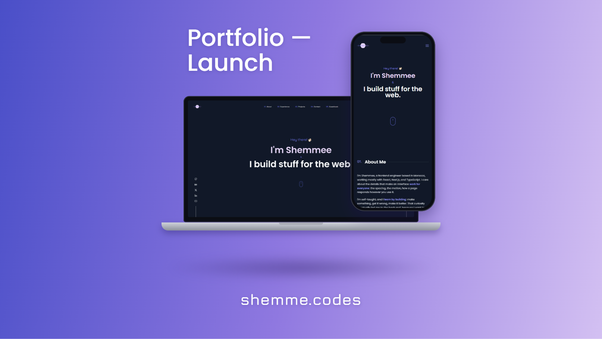
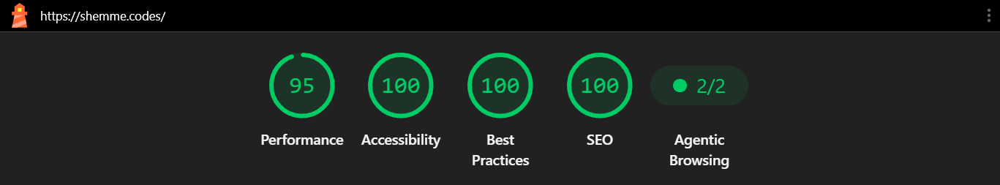

# SHEMME CODES | Front-End Portfolio Template

A responsive, accessible, single-page portfolio built with Next.js, TypeScript and Tailwind CSS. Fork it, replace the content, and deploy.



## Features

- **Responsive layout** for desktop, tablet and mobile.
- **Accessible by default:** semantic landmarks, visible focus states, keyboard navigation, a labelled contact form and support for reduced motion.
- **Dark and light themes** with a toggle and system preference detection.
- **Contact form** with validation, a honeypot field and email delivery through Nodemailer.
- **Guestbook demo:** visitors draw a 16x16 pixel icon and it appears on a wall. In this template, drawings are stored in the visitor's own browser. See [Guestbook](#guestbook) to connect a backend.
- **SEO basics:** metadata, Open Graph support, sitemap and robots file.
- **Performance:** optimised fonts and images, preloaded resources and lazy-loaded sections.

## Tech stack

| Area      | Tools                                |
| --------- | ------------------------------------ |
| Framework | Next.js, React, TypeScript           |
| Styling   | Tailwind CSS                         |
| Animation | Framer Motion                        |
| Email     | Resend                           |
| Testing   | Jest, React Testing Library          |
| Tooling   | ESLint, Prettier, Husky, lint-staged |
| Hosting   | Vercel                               |

## Lighthouse

The report below was generated for the original site. Run Lighthouse on your own deployment, because your scores depend on your content and images.



## Getting started

You can click **Use this template** on GitHub, or fork the repository. You need Node.js 18 or newer and Yarn.

```bash
git clone https://github.com/s-shemmee/shemme-codes-portfolio.git
cd shemme-codes-portfolio
yarn install
cp .env.example .env.local
yarn dev
```

Open [http://localhost:3000](http://localhost:3000).

### Environment variables

The contact form needs two variables in `.env.local`:

| Variable | Purpose |
| --- | --- |
| `RESEND_API_KEY` | API key from your Resend account |
| `RESEND_FROM_EMAIL` | Sender address (use `onboarding@resend.dev` for testing) |
| `RECEIVING_EMAIL` | Address that receives contact form messages |

Without them the site still runs, but sending a message returns an error. Add the same variables in your hosting provider's settings when you deploy.

### Scripts

| Command      | What it does                 |
| ------------ | ---------------------------- |
| `yarn dev`   | Start the development server |
| `yarn build` | Create a production build    |
| `yarn start` | Serve the production build   |
| `yarn lint`  | Run ESLint                   |
| `yarn test`  | Run the tests                |

## Make it yours

| What                                | Where                                                                     |
| ----------------------------------- | ------------------------------------------------------------------------- |
| Name, site URL, SEO text            | `src/app/layout.tsx`                                                      |
| Social links, email, repository URL | `src/data/urls.json`                                                      |
| Projects                            | `src/data/projects.json` and `public/images/`                             |
| About, experience and toolbox text  | `src/components/section/`                                                 |
| Portrait                            | `public/ascii/portrait.txt`                                               |
| Colors and fonts                    | `tailwind.config.ts` and `src/app/layout.tsx`                             |
| Share images                        | Add `opengraph-image.png` and `twitter-image.png` (1200x630) to `src/app` |
| Favicons                            | `public/icons/`                                                           |

The footer shows your repository's GitHub stars and forks, using the `portfolioRepository` value in `src/data/urls.json`.

## Guestbook

The guestbook lives at `/guestbook`. Visitors pick colors, draw on a 16x16 grid and submit. In this template, submissions are saved in the visitor's browser (`localStorage`), so each visitor sees only their own drawings plus the sample ones.

To share drawings between visitors, you need a database and a small API:

1. Save submissions on the server instead of in the browser, after validating them with `src/lib/guestbook/validate.ts`.
2. Replace the submit handler in `src/components/guestbook/GuestbookEditor.tsx` with a request to your API.
3. Load entries from your API in `src/components/guestbook/PixelWall.tsx`.

Public submissions can include offensive drawings, so consider adding moderation, rate limiting and a spam check before you go live.

## Contributing

Issues and pull requests are welcome. Please run `yarn lint` and `yarn test` before opening a pull request.

## License

Released under the MIT License. You are free to use, modify and distribute this project. Please keep the license notice.
